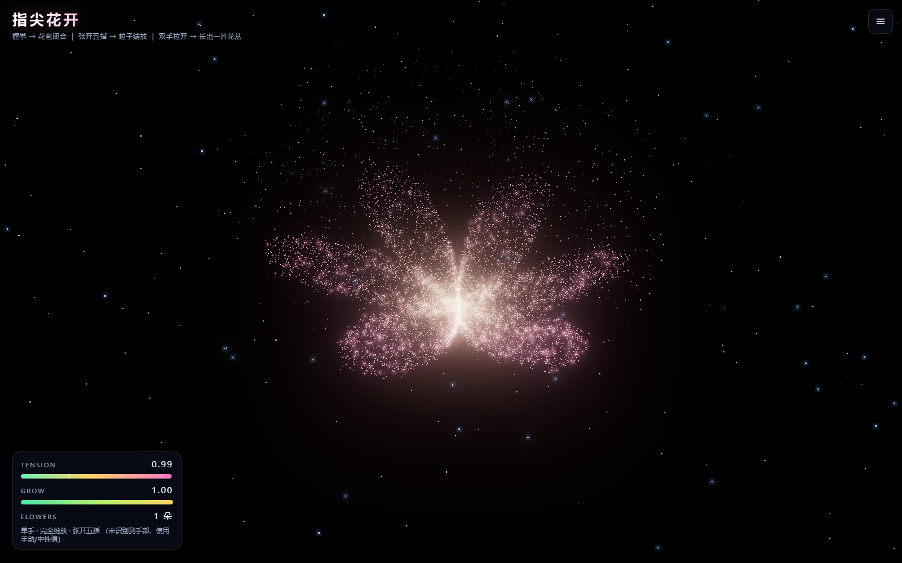
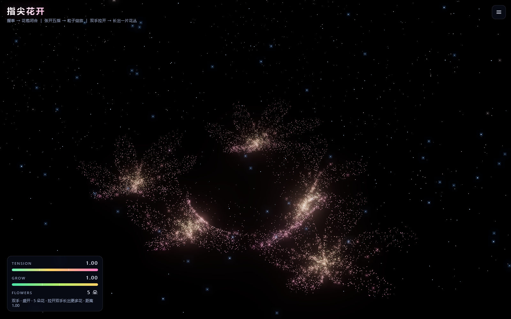
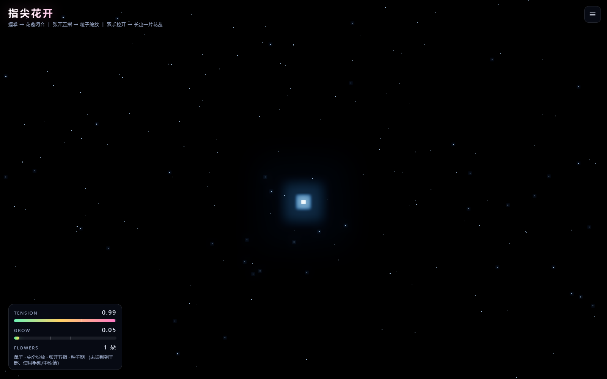
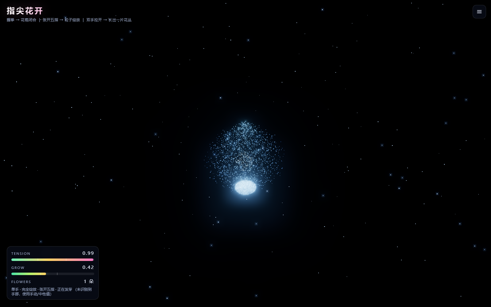
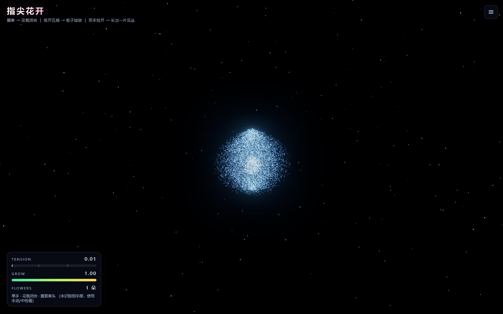

# 指尖花开 · 手势控制的 Three.js 粒子花朵

> 用摄像头识别手部 21 个关键点，把「手掌张开度」映射成粒子花朵的绽放程度。
> **握拳 → 花苞闭合；张开五指 → 粒子向外绽放。**
>
> 支持**单手**与**双手**两种交互模式，并带有一段**种子 → 发芽 → 花苞 → 开花**的生长动画。

<p align="center">
  <a href="https://zcx20070505.github.io/gesture-flower/">
    
  </a>
</p>
<p align="center">
  <strong>👉 <a href="https://zcx20070505.github.io/gesture-flower/">点击打开在线 Demo</a>（无需安装，允许摄像头即可）</strong>
</p>

> 💡 在线 Demo 部署在 GitHub Pages（HTTPS），摄像头权限可正常使用。
> 手机浏览器同样可以打开，用前置摄像头体验。

<p align="center">
  
  
</p>
<p align="center">
  <em>左：单手模式，张开五指完全绽放　|　右：双手模式，双手拉开长出一片花丛</em>
</p>

<p align="center">
  
  
  
</p>
<p align="center">
  <em>生长动画三阶段：种子 → 发芽 → 花苞</em>
</p>

## 功能特性

- 🖐 **真实手势识别** —— MediaPipe Hands 实时追踪手部 21 个关键点（最高 60fps）
- ✊ **握拳 / 张开放** —— 手掌张开度经尺度归一化 + 帧率无关平滑，映射为绽放程度
- 🙌 **双手交互** —— 双手距离决定花朵数量（1~5 朵）、双手开合推进生长、转动双手旋转花丛
- 🌱 **生长动画** —— 种子 → 发芽 → 花苞 → 开花，带破土抖动与错峰开花
- 🌸 **GPU 粒子花朵** —— 5000~20000 颗粒子，顶点着色器内完成位置/颜色/尺寸插值，一次 draw call
- ✨ **数学花瓣** —— 极坐标玫瑰曲线 `r(θ) = |cos(kθ/2)|^sharp` 生成花瓣轮廓
- 🎨 **泛光与渐变** —— 加法混合 + UnrealBloom 泛光，中心金黄到外缘玫粉的 HSL 渐变
- 📱 **响应式** —— 桌面右侧抽屉 / 移动端底部抽屉，适配刘海屏安全区
- 🛟 **健壮降级** —— 摄像头各种失败场景都有中文提示，并能自动退回手动模式

## 交互说明

### 两种模式（面板顶部二选一，随时可切换）

| 模式 | 玩法 |
|---|---|
| **单手交互** | 握拳闭合 · 张开五指绽放 · 手掌移动让花朵轻摆 |
| **双手交互** | 双手拉开长出花丛（1→5 朵）· 双手开合推进生长 · 转动双手旋转花丛 · 整体移动平移花丛 |

**两种模式互斥**：选单手时完全忽略第二只手；选双手时第二只手才参与运算。
切换会立刻清理共享状态，不需要重启摄像头。

### 手势速查

**单手模式**

| 动作 | 效果 |
|---|---|
| 握拳 | 花苞闭合（张力 → 0） |
| 张开五指 | 粒子绽放（张力 → 1） |
| 手掌移动 | 花朵跟随轻摆 / 俯仰 |

**双手模式**

| 动作 | 效果 |
|---|---|
| 双手拉开 / 并拢 | 长出一片花丛（1 → 5 朵）/ 收回成一朵 |
| 双手同时张开 | 推进生长（种子 → 开花） |
| 转动双手 | 整片花丛旋转 |
| 双手整体移动 | 花丛平移 |

> 双手模式下只举一只手也能用：花朵保持 1 朵，HUD 会提示"举起第二只手"。

---

## 快速开始

### 方式零：在线直接玩（最快）

打开 **<https://zcx20070505.github.io/gesture-flower/>** → 点「开始体验」→ 允许摄像头。

无需安装任何东西。手机同样可用（建议横屏）。

### 方式一：本地静态服务（零构建，推荐）

```bash
git clone https://github.com/zcx20070505/gesture-flower.git
cd gesture-flower

# 起一个本地 HTTP 服务（三选一）
python serve.py --port 5500     # 项目自带，带父进程监视
python -m http.server 5500      # 或者用标准库
npx serve -l 5500 .             # 或者用 Node
```

然后浏览器打开 **<http://127.0.0.1:5500/>**，点击「开始体验」并允许摄像头。

> ⚠️ **必须通过 HTTP 打开**。直接双击 `index.html`（`file://` 协议）时浏览器会禁用摄像头，
> 程序里也专门做了这个错误的提示。

### 方式二：npm + Vite

```bash
npm install        # 安装 three / vite
npm run dev        # 开发服务器（默认 5173 端口）
npm run build      # 生产构建，产物在 dist/
npm run preview    # 预览构建产物
```

用 Vite 时可以把 `index.html` 里的 `<script type="importmap">` 删掉 ——
Vite 会自动解析 `three` 和 `three/addons/...` 这两个说明符。

### 依赖

| 依赖 | 版本 | 引入方式 |
|---|---|---|
| Three.js | 0.169.0 | CDN（jsDelivr）或 npm |
| MediaPipe Hands | 0.4.1675469240 | CDN（UMD，挂 `window.Hands`）或 npm `@mediapipe/hands` |

CDN 版本已在 `index.html` 的 `importmap` 与末尾 `<script>` 中固定，无需额外配置。

### 可选：Windows 桌面图标

项目附带了一套 Windows 启动器，可以把程序变成一个"双击就用"的桌面应用：

```powershell
# 1) 生成图标（可选，仓库里已带 icon.ico）
node make-icon.mjs

# 2) 在桌面创建快捷方式（右键 → 使用 PowerShell 运行）
.\创建桌面快捷方式.ps1
```

双击图标后会：起本地服务 → 用 Edge 应用模式打开（无地址栏）→ 关窗口时自动清理服务。
如果不用 Windows，忽略这部分即可，网页本身是跨平台的。

> `launcher.ps1` 里的项目路径默认写死为作者本机路径，请按需修改 `$AppDir`。

---

## 项目结构

```
gesture-flower/
├── index.html            页面结构：画布层、HUD、控制面板、启动遮罩
├── style.css             样式：全屏沉浸布局、毛玻璃面板、响应式与安全区适配
├── main.js               全部逻辑（按 §0~§7 分节，见文件头注释）
├── package.json          npm / Vite 可选依赖
├── serve.py              内置 HTTP 服务（带父进程监视，防僵尸进程）
│
├── verify.mjs            离线自检：数学公式 + GLSL 静态检查 + DOM 契约（134 项）
├── browser-test.mjs      浏览器测试：真实渲染、模式切换、双手交互、生长动画、降级（87 项）
├── docs/
│   ├── shots.mjs         README 配图的生成脚本
│   └── screenshots/      展示截图
├── .github/workflows/
│   └── pages.yml         自动部署到 GitHub Pages
│
│  ── 以下为 Windows 桌面图标相关（非 Windows 可忽略）──
├── start.bat             桌面图标入口（纯 ASCII 转发脚本）
├── launcher.ps1          启动器逻辑（起服务 + 开应用窗口 + 退出清理）
├── 创建桌面快捷方式.ps1      在桌面创建快捷方式
├── icon.ico              桌面图标（16~256 六种尺寸）
├── make-icon.mjs         图标生成脚本（纯 Node 画 PNG + ICO，无第三方依赖）
└── README.md             本文档
```

### 部署到 GitHub Pages

线上地址：**<https://zcx20070505.github.io/gesture-flower/>**

推送到 `main` 分支即自动部署，流程定义在 `.github/workflows/pages.yml`：

1. 检出代码，`actions/configure-pages` 首次运行时自动在仓库设置里启用 Pages
2. 只把 `index.html` / `style.css` / `main.js` / 图标 复制到 `_site`
   （`serve.py`、`launcher.ps1`、测试脚本这些开发用文件**不会**出现在站点上）
3. 写入 `.nojekyll`，避免 Jekyll 处理
4. `upload-pages-artifact` + `deploy-pages` 发布

**本项目是纯静态站点**：Three.js 与 MediaPipe 都走 CDN，不需要 `npm install` 和构建步骤。

> **Fork 后自己部署**：进仓库 Settings → Pages → Source 选 **GitHub Actions**，
> 然后把 `pages.yml` 里无需改动（路径都是相对的），推送即可。
> 若你的仓库名不叫 `gesture-flower`，站点地址会变成
> `https://<用户名>.github.io/<仓库名>/`，其余无需改动 —— 因为所有资源引用都是相对路径。

`main.js` 的模块划分：

| 小节   | 内容                                                             |
| ---- | -------------------------------------------------------------- |
| §0   | `CONFIG` —— 所有可调参数集中在此                                         |
| §1   | 工具函数：`clamp` / `damp`（帧率无关平滑）/ `smoothstep` / `tensionToBloom` |
| §2   | `HandTracker` —— MediaPipe Hands 封装（支持双手）+ 骨架绘制 + 摄像头错误翻译      |
| §2.5 | `TwoHandController` —— 双手距离/开合/旋转/中点 → 花丛参数                     |
| §2.6 | `GrowthAnimator` —— 种子→发芽→花苞→开花的时序曲线                            |
| §2.7 | `ClusterLayout` —— 黄金角螺旋布局，决定多朵花怎么摆                              |
| §3   | `TensionMeter` —— 21 关键点 → 张力 0~1                              |
| §4   | `FlowerField` —— 粒子几何体生成 + 顶点/片元着色器（含多花簇）                        |
| §5   | `Stage` —— Three.js 场景、摄像头背景、泛光后期、响应式                          |
| §6   | `UI` —— 面板、HUD、启动遮罩、错误提示                                       |
| §7   | `App` —— 装配以上模块，主渲染循环                                          |

---

## 核心算法

### 3.1 手掌张开度 tension（`TensionMeter.update`）

**记号**：`D(a→b)` 表示关键点 a 到 b 的距离，取 `wrist = 关键点 0`。

```
① 手掌尺度基准（尺度归一化，消除手掌离镜头远近的影响）
   D_palm = D(wrist → 9)              9 是中指 MCP（指关节）
   选 9 是因为食指/中指 MCP 在握拳与张开时位移最小，是最稳定的参考

② 五根指尖到手腕的平均距离（含拇指尖 4）
   D_tip = ( D(0→4) + D(0→8) + D(0→12) + D(0→16) + D(0→20) ) / 5

③ 相对张开度
   raw_relative = D_tip / D_palm − 1
   · 握拳时指尖蜷回掌心 → D_tip ≈ D_palm      → raw_relative ≈ 0
   · 全张开时指尖远离手腕 → D_tip ≈ 2 × D_palm → raw_relative ≈ 1

④ 归一化 + 灵敏度
   t_instant = clamp( clamp(raw_relative × openGain, 0, 1) × gain, 0, 1 )
   openGain 默认 1.4，相当于把 [0, 0.715] 映射到 [0,1]，让中等张开就接近满值

⑤ 指数平滑（帧率无关）
   keep      = (1 − smoothing) ^ (dt × 60)
   tension  += (t_instant − tension) × (1 − keep)
   把 smoothing 解释成「60fps 下每帧保留的比例」，
   于是 30fps / 60fps / 120fps 在同一段时间内衰减总量完全一致
   （verify.mjs 里有断言：三种帧率推进 1 秒后结果极差 < 1e-9）
```

为什么这样设计：

- **除以 `D_palm` 做尺度归一化** —— 手离镜头远近不影响结果。测试验证：手整体缩小到 0.55 倍，tension 变化 < 0.02。
- **除以 5 取均值** —— 避免单根手指抖动导致数值跳变。
- **拇指用指尖 4 而非关节 3** —— 握拳时关节 3 仍离手腕较远，会让「握拳」读数偏高。
- **退化输入保护** —— 21 点重合（MediaPipe 异常输出）时结果为 0，不产生 NaN。

### 3.2 张力 → 绽放度 `tensionToBloom`

```
t       = clamp( (tension − 0.32) / (0.66 − 0.32) )      // 归一化
core    = t²(3 − 2t)                                      // smoothstep，S 形
envelope= 1 + 0.22 × sin(πt)                              // 钟形包络，中段隆起
bloom   = clamp( core × envelope × bloomMax, 0, bloomMax )
```

| tension     | bloom    | 视觉               |
| ----------- | -------- | ---------------- |
| ≤ 0.32      | 0        | 花苞闭合，粒子聚合        |
| 0.32 ~ 0.66 | 0 → 1.35 | 平滑绽放（中段最快）       |
| ≥ 0.66      | 1.35     | 完全绽放，粒子扩散、花心种子喷发 |

- `bloomMax = 1.35 > 1`：着色器里 `bloom > 1` 会触发花心种子向上喷发（见顶点着色器 §⑥）。
- `envelope` 让曲线在过渡区中段最快张开、到高张力端回落成正好 `bloomMax`，  
  于是花朵是「唰」地打开再稳稳停住，而不是线性地慢慢爬到底。
- **阈值判定带迟滞**（`hysteresis = 0.05`）：只在越过对侧阈值时才切换状态，  
  避免张力在 0.32 / 0.66 附近抖动导致花朵反复开合。

### 3.3 粒子花朵的数学构造（`FlowerField.build`）

每颗粒子保存**两组位置**与**两组颜色**，顶点着色器用 `uBloom` 在两者间插值。

**绽放形态** —— 极坐标玫瑰曲线：

```
θ    = U(0, 2π)
r(θ) = |cos(k·θ / 2)|^sharp          k = 花瓣数，sharp = 0.75
radius = r(θ) × sqrt(U(0,1)) × PETAL_R × bloomScale
```

`sqrt` 让粒子在花瓣**面积**上均匀分布（否则会中心过密）。  
`sharp < 1` 让花瓣更瘦、瓣与瓣之间凹陷更深 —— 这是花朵「有花瓣」而不是  
「一个圆盘」的关键。已验证：k = 3/6/9 时曲线恰好有 3/6/9 个瓣尖。

**花苞形态** —— 有体积的水滴形：

```
① 单位球内体积均匀采样：cosθ ~ U(−1,1)，φ₀ ~ U(0,2π)，r ∝ U^(1/3)
② 水滴包络：底部饱满、顶部收尖
   envelope = sin( hNorm^0.75 × π × 0.86 + 0.12 )     hNorm = 0(底) → 1(顶)
③ 绕 y 轴轻微扭曲：twist = (hNorm) × coilTurns × 0.9
   越靠上扭转越多，形成花瓣层层包裹的观感
```

> **踩坑记录**：最初把半径和角度都绑在同一个归一化序号 `u` 上  
> （`r = sin(uπ)·R`，`φ = u·turns·2π`），结果粒子只排成一根细螺旋线，  
> 花苞看起来像个「圈」。**花苞必须是有体积的实体，而不是一条曲线** ——  
> 上面改成「球内采样 + 水滴包络」后才正确。

### 3.4 性能：为什么几万粒子也能 60fps

- 位置插值、颜色插值、旋转、尺寸、飘动、跟手位移**全部在顶点着色器**完成，  
  CPU 每帧只更新几个 uniform。
- `THREE.Points` + `AdditiveBlending`，一次 draw call 画完全部粒子。
- `depthWrite: false` 避免粒子互相遮挡出黑边。
- 指尖排斥用 `exp(-d²)` 衰减，只影响附近粒子。

**注意**：绽放与否**不会**改变绘制的顶点数（顶点数恒等于粒子数），  
变化的是 uniform 驱动的粒子位置 —— 这正是性能设计的关键。  
`browser-test.mjs` 里断言的是 `uBloom` 真的从 0 变成 1.35，而不是绘制量变化。

### 3.5 交互模式：为什么做成"二选一"而不是开关

早期版本是一个「启用双手模式」复选框，效果是"双手功能可叠加在单手之上"。
实际用起来有两个问题：

1. **行为含糊** —— 勾上之后，举一只手和举两只手的体验不一样，
   用户不知道当前到底在按哪套规则走。
2. **状态泄漏** —— 从双手切回单手的瞬间，`twoHand.span` 还停在 `1.0`（5 朵花），
   要等它慢慢 `damp` 回 0，中间会看到花朵数量缓慢减少的怪现象。

所以改成**显式的二选一**（`CONFIG.mode: 'single' | 'two'`）：

- **互斥**：单手模式直接给 `TwoHandController` 喂空数组，
  它走"无双手"分支，第二只手**完全不参与任何运算**。
- **切换即生效**：`App.setMode()` 会主动清掉一批跨帧残留状态
  （`span` / `openness` / `rotationAccum` / `_lastRawRot` / 场景平移 / 花朵数量），
  不需要等平滑收敛。
- **UI 联动**：切到单手时收起双手专属选项、换成单手操作说明；
  HUD 也加上 `单手 ·` / `双手 ·` 前缀。

判定链是这样的（`App._frame`）：

```js
const twoHandMode = CONFIG.mode === 'two';
this.twoHand.update(twoHandMode && cameraOn ? handsData : [], dt);
const twoActive = twoHandMode && cameraOn && this.twoHand.active;

// 花朵数量：单手模式恒为 1
const wantCount = (CONFIG.multiCluster && twoActive)
  ? ClusterLayout.countForSpan(span) : 1;
```

注意 `twoActive` 同时被三处门控（模式、摄像头、真的检测到两只手），
这正是 `verify.mjs` 里那组"单手模式下即使检测到双手也只开 1 朵"断言的依据。

### 3.6 双手交互（`TwoHandController`）

一只手只能表达「张开度」一个自由度。加上第二只手后多出 4 个通道：

| 输入 | 计算 | 输出 |
|---|---|---|
| 双手距离 | `distNorm = 双掌心距离 / 平均手掌尺寸` | 花朵数量 1~5 |
| 双手开合 | `max(左手张力, 右手张力)` | 生长进度 |
| 两掌连线角度 | `atan2(-dy, dx)` + 最短路径解包 | 花丛旋转 |
| 双手中点 | `((1-pax)+(1-pbx))/2`（镜像后） | 花丛平移 |

**① 距离 → 花朵数量**

```
distNorm = dist / ((palm_A + palm_B) / 2)      ← 除以手掌尺寸，消除镜头距离影响
span     = clamp((distNorm − 1.2) / (4.5 − 1.2))
count    = round(1 + (maxClusters − 1) × span)
```

除以手掌尺寸是关键：无论手离镜头远近，读数都一致（已验证：整体缩放 0.45 倍后 span 变化 < 0.02）。

**② 角度回绕（容易踩的坑）**

`atan2` 的值域是 `(-π, π]`，当两掌连线从 +179° 转到 +181° 时，输出会从 `+3.124` 突跳到 `-3.124`。
若直接累加，旋转会瞬间反向甩一整圈。做法是取**最短路径增量**再累积：

```js
let delta = raw - last;
while (delta >  Math.PI) delta -= Math.PI * 2;
while (delta < -Math.PI) delta += Math.PI * 2;
```

`verify.mjs` 里既验证了「解包后总变化 = 真实转角」，也用对照实验证明了「不解包会产生 ≈-2π 的跳变」。

**③ 左右手不乱序**

MediaPipe 的 `multiHandLandmarks` 顺序随手出现次序变化，直接用下标 0/1 会让左右手"串位"。
这里按 `handedness` 的 label 排序（Left 在前），索引才稳定；同时把摄像头视角的
Left/Right 换算成用户视角，避免提示与实际相反。

### 3.7 生长动画（`GrowthAnimator`）

把「种子 → 发芽 → 花苞 → 开花」做成一条时间轴，进度 `g ∈ [0,1]`：

```
g ∈ [0, 0.35]              种子期：贴在土里，蓄力不动
g ∈ [0.35, 0.55]           破土期：easeOutBack 加速长出（末端轻微过冲，像顶出来）
g ∈ [0.55, 1]              开花期：easeInOut 张开花瓣
```

**为什么分段**：一条 `easeInOut` 从头用到尾的话，种子期会"还没站稳就开始长"，
看起来像被拉伸而不是生长。分段后先慢、再猛、再稳，才像真的发芽。

着色器里两段插值分开做，`g` 管「种子→花苞」，`b` 管「花苞→绽放」：

```glsl
vec3 pos = mix(aPosSeed, aPosBud, smoothstep(0.0, 0.55, g));
pos      = mix(pos, aPosBloom, clamp(b, 0.0, 1.0));
```

**破土抖动**：生长前期叠加高频抖动 + 整体上抬，模拟顶开土壤：

```glsl
float sprout = (1.0 - smoothstep(0.1, 0.65, g)) * step(0.01, g);
pos.x += sin(uGrowTime * 22.0 + aSeed * 40.0) * 0.035 * sprout;
```

**错峰生长**：第 i 朵花的时间轴滞后 `clusterStagger × i`，于是花丛是「一朵接一朵」冒出来，
而不是整齐划一地同时长。已验证：`progress=1` 时最后一朵也能完全长成（不会卡在幼苗）。

### 3.8 多花簇如何在一次 draw call 里画完

所有花共用同一个 `BufferGeometry`，每颗粒子多一个属性 `aCluster`（属于第几朵花）。
顶点着色器按索引取出该簇的位置/缩放/绽放度，最后 `pos = pos * cScale + cPos`。

**GLSL ES 1.00 的限制**：uniform 数组只能用**常量表达式**索引，
不能写 `uClusterPos[ci]`（ci 是变量）。所以必须用 for 循环逐项比较：

```glsl
for (int i = 0; i < MAX_CLUSTERS; i++) {
  if (i == ci) { cPos = uClusterPos[i]; /* ... */ }
}
```

`MAX_CLUSTERS` 由 JS 注入（着色器里写 `__MAX_CLUSTERS__` 占位符，构建时替换成
`CONFIG.maxClusters`），两边不会写死后不一致。

**注意**：着色器本身是 JS 模板字符串，占位符**不能**写成 `${...}` —— 那样会被立刻求值并
抛 `ReferenceError`。这个坑已经踩过并写进 `verify.mjs` 的断言。

**花朵数量变化时不会"跳"**：数量用浮点平滑（`_clusterCount`），
每朵花的 `scale` 与 `pos` 各自做 `damp`/`lerp`，所以增减花朵是渐入渐出。

### 3.9 ⚠️ 一个非常隐蔽的渲染坑：未激活的花簇会塌缩成白块

这是开发过程中最难定位的一个 bug，放在这里供后来者参考。

**现象**：画面上除了花朵，还多出一个**白方块**和一根**白线**。
它跟随相机、不随花朵旋转，用 `gl.getError()` 也查不出任何问题。

**排查走过的弯路**（都不对）：怀疑 `gl_PointSize` 过大 → 怀疑负数尺寸 →
怀疑噪声函数产生 NaN → 怀疑泛光后期 → 怀疑驱动（SwiftShader）。
一度以为是软件渲染的怪癖，后来用真实显卡（RTX 5060）复现才确认是真 bug。

**真正的原因**：多花簇模式下，未激活的花簇 `uClusterScale = 0`，而着色器里算的是

```glsl
pos = pos * cScale + cPos;   // cScale=0, cPos=(0,0,0)
```

于是该簇**所有粒子都被压到原点 (0,0,0)**。单朵花时，这意味着 4/5 的粒子（约 9600 颗）
堆在同一个像素上 —— 加法混合直接把那里烧成纯白，再被 UnrealBloom 拉成一条亮线。

**正确的修法**：不是把它们丢掉（那样单朵花只剩 1/5 粒子，会变得又稀又暗），
而是**把未激活簇的粒子重定向到第 0 簇**，让它们沿同一套花瓣几何叠加：

```glsl
float cActive = step(0.001, cScale);
vec3  usePos   = mix(uClusterPos[0],   cPos,   cActive);
float useScale = mix(uClusterScale[0], cScale, cActive);
pos = pos * useScale + usePos;
```

这样无论开几朵花，粒子总数始终全部用上，密度恒定、形状也不会被揉散。

> **教训**：任何"用一个 0 去乘坐标"的地方，都要想清楚那一帧这些顶点会跑到哪里。
> 它们不会消失，而是会叠在某一个点上爆炸式地变亮。

---

## 可调参数（`main.js` 顶部 `CONFIG`）

| 参数               | 默认    | 说明                     |
| ---------------- | ----- | ---------------------- |
| `particleCount`  | 12000 | 粒子数，5000 ~ 20000（面板可调） |
| `petalCount`     | 6     | 花瓣数量                   |
| `petalSharp`     | 0.75  | 花瓣形状指数，越小瓣越瘦、瓣间凹陷越深    |
| `coilTurns`      | 2.4   | 花苞包裹的扭曲程度              |
| `sizeBase`       | 1.5   | 粒子基础尺寸（像素）             |
| `bloomScale`     | 1.05  | 花瓣半径放大倍数               |
| `lowTension`     | 0.32  | 花苞阈值下沿                 |
| `highTension`    | 0.66  | 绽放阈值上沿                 |
| `bloomMax`       | 1.35  | 绽放度上限（>1 触发种子喷发）       |
| `bloomOvershoot` | 0.22  | 过渡区中段的张开加速包络           |
| `smoothing`      | 0.18  | 张力平滑系数，越小越平滑（面板可调）     |
| `gain`           | 1.0   | 灵敏度增益（面板可调）            |
| `openGain`       | 1.4   | 张开度归一化区间放大倍数           |
| `hysteresis`     | 0.05  | 阈值迟滞带宽，防抖动             |
| `lostTimeout`    | 900   | 丢失手部后开始回落的中性值延时（ms）    |
| `bloomStrength`  | 0.42  | 泛光强度（调高会把花朵糊成白团）       |
| `maxPixelRatio`  | 2     | 渲染分辨率上限，防 4K 屏掉帧       |
| `maxClusters`    | 5     | 最多几朵花（会同步注入到 GLSL 的 `MAX_CLUSTERS`） |
| `mode`           | 'two' | 交互模式：`'single'` 单手 / `'two'` 双手 |
| `multiCluster`   | true  | 是否允许一朵以上（关掉则永远 1 朵，仅双手模式） |
| `clusterSpread`  | 1.7   | 多朵花之间的散布半径（太大会开出画面）      |
| `clusterShrink`  | 0.34  | 花越多、单朵越小（5 朵时约缩到 0.6）    |
| `clusterStagger` | 0.18  | 各朵花生长/开花的错峰程度            |
| `twoHandRotate`  | 1.0   | 双手旋转 → 花丛旋转的灵敏度           |
| `twoHandPan`     | 0.9   | 双手中点位移 → 花丛平移的灵敏度        |
| `maxHands`       | 2     | 识别几只手上限（设 1 则双手模式不可用）     |
| `growDuration`   | 3.2   | 生长动画总时长（秒）               |
| `growSeedHold`   | 0.35  | 种子停留阶段占比                 |
| `growSprout`     | 0.55  | 「种子→花苞」完成时的进度占比          |
| `autoGrowOnStart`| true  | 启动时自动播一次生长动画             |

面板里还能实时调：**交互模式（单手/双手）**、手动张力、平滑系数、增益、粒子数、花瓣数、
绽放偏移、自动旋转速度、**多朵花开关**、**手动生长进度**与**重新播放生长动画**，
以及摄像头背景 / 骨架 / HUD 开关。

---

## 错误处理

| 场景                             | 行为                                     |
| ------------------------------ | -------------------------------------- |
| 浏览器不支持 `getUserMedia`          | 提示改用 Chrome/Edge/Safari 并通过 http(s) 打开 |
| MediaPipe 脚本未加载                | 提示检查网络或改用 npm 安装                       |
| 权限被拒绝（`NotAllowedError`）       | 中文提示如何在地址栏重新授权                         |
| 没有摄像头（`NotFoundError`）         | 提示连接摄像头设备                              |
| 摄像头被占用（`NotReadableError`）     | 提示关闭会议软件/相机应用                          |
| 分辨率不支持（`OverconstrainedError`） | 提示更换设备                                 |
| `file://` 协议（`SecurityError`）  | 提示使用 https 或 localhost                 |
| **任意摄像头失败**                    | **自动降级到手动模式**，花朵照常渲染，可用滑块体验            |
| 丢失手部 > 900ms                   | 张力平滑回落到中性值 0.45，花朵半开待机而非卡死             |
| 页面切到后台                         | 暂停渲染省电，切回自动恢复                          |
| 单帧识别失败                         | 记录后继续，不中断循环                            |

---

## 测试与验证

项目自带两套测试，都已全部通过。

### 离线自检（无需浏览器，134 项）

```bash
node verify.mjs
```

覆盖：张力公式（含尺度/位置不变性、退化输入）、绽放映射（单调性、上下界、  
阈值边界）、帧率无关平滑、GLSL 静态检查（varying 一致性、uniform 与 JS 对齐、  
顶点属性对应、类型错误、花括号配对）、DOM id/class 契约、响应式与无障碍、  
需求覆盖。

### 浏览器冒烟测试（真实 Chromium + WebGL，87 项）

```bash
# 先起 http 服务
python -m http.server 5500
# 另开一个终端
node browser-test.mjs
```

覆盖：模块加载、WebGL2 上下文、**着色器真实编译链接**（12 个 program、
`gl.getError() === 0`）、**粒子真实光栅化**（一帧内提交 12000 个顶点）、
`uBloom` 驱动验证、HUD 状态机、控件交互、摄像头链路、响应式（竖屏布局）、
**交互模式切换**（单手/双手 UI 联动、状态清理、互斥性）、
**双手交互**（距离→花朵数量 1↔5、开合→生长、旋转→场景旋转）、
**生长动画**（阶段时序、传导到花簇、滑块接管与交还）、
运行时零异常、**权限拒绝的降级路径**。截图输出到 `.test-output/`。

> **测试踩坑记录**（写在这里，避免以后重蹈覆辙）：
>
> 1. `canvas.drawImage(webglCanvas)` 取像素永远全黑 —— 没开
>    `preserveDrawingBuffer` 时缓冲区在帧结束后已清空，这是 WebGL 正常行为。
> 2. 不能用 `renderer.info.render` 判断花朵画没画 —— 本项目走
>    `EffectComposer`，一帧有多个 pass，而 `info` 每次 `render()` 都会重置，
>    读到的是最后一个全屏 pass 的数字（`points` 恒为 0）。
>    正确做法是 monkey-patch `renderer.renderBufferDirect` 累加整帧。
> 3. `--use-fake-ui-for-media-stream` 会无条件自动授权，连
>    `clearPermissions()` 都拦不住，导致「权限拒绝」分支永远测不到。
>    测降级必须另开一个不带该参数的浏览器实例，并在页面里覆写
>    `getUserMedia` 让它 reject。
> 4. **不能用 `new Function(...)` 拼字符串喂给 `page.evaluate`** ——
>    Playwright 会把函数序列化后注入页面，`new Function` 生成的闭包无法正确
>    序列化，参数不会绑定（`sepX` 变成 `undefined`），于是算出一堆 `NaN`
>    并伪装成"程序有 bug"。必须写成普通的可序列化函数，参数走 `evaluate` 第二参。
> 5. **`dt` 被裁到 0.05s，动画时长要按帧数而非墙钟时间等** ——
>    主循环为防切标签页跳变会把 `dt` 截断，于是 3.2s 的动画需要 64 帧。
>    在 SwiftShader 软件渲染（约 5fps）下等于约 13 秒真实时间；
>    测试若只等 4 秒就会误判"动画没跑完"。改为轮询 `autoPlaying` 复位。
> 6. **测试夹具的量纲要贴近真实** —— 双手距离的 `distNorm` 定义域约
>    1.2~4.5（距离 / 手掌尺寸）。一开始夹具把掌心距离设成手掌尺寸的 2 倍和
>    5 倍，两者都饱和到 `span=1`，看着像"距离不影响花朵数量"的 bug。

---

## 浏览器兼容性

| 浏览器               | 状态                      |
| ----------------- | ----------------------- |
| Chrome / Edge 88+ | ✅ 推荐                    |
| Safari 15+（含 iOS） | ✅ 支持（`playsinline` 已处理） |
| Firefox           | ✅ 支持（MediaPipe 在部分版本较慢） |

需要 **WebGL2**（Three.js r169 默认走 WebGL2 渲染器）与摄像头权限。

---

## 已知限制

- MediaPipe Hands 的 `window.Hands` 依赖 CDN；离线环境需改用 npm 本地安装。
- 单手识别（`maxHands: 1`）；双手需要扩展 `TensionMeter` 与 `HandTracker`。
- 摄像头画面是**半透明叠加**（`opacity 0.22`），不是全屏不透明背景 —— 避免  
  背景抢走粒子的对比度。
- 姿态在强逆光/手部快速移动时识别会短暂丢失，此时张力按 §5 规则平滑回落。
